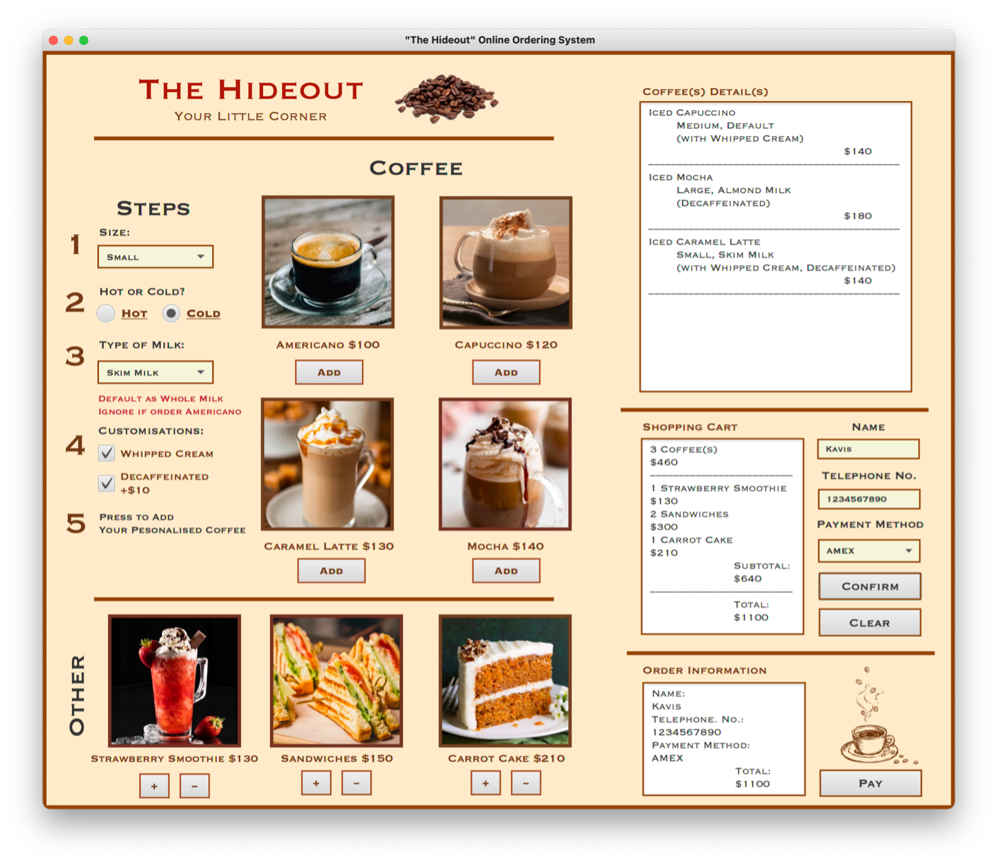
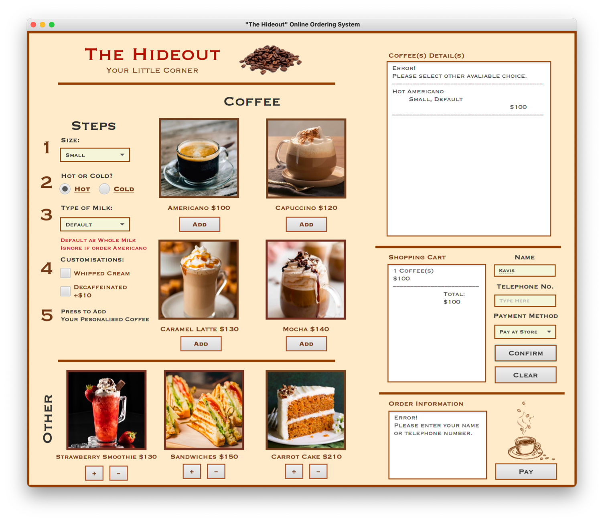

# The Hideout – Online Ordering System

A JavaFX-based online ordering system developed for a fictional coffee shop. The application allows customers to customise coffee orders, select food items, manage their shopping cart, and review order details through a graphical user interface.

## Project Overview

The Hideout is a fictional coffee shop online ordering system developed as an individual academic project using Java and JavaFX.

The application provides an interactive ordering experience, allowing customers to customise beverages, select additional food items, and review their orders before confirmation. The interface was designed using JavaFX Scene Builder, with FXML defining the layout and Java controllers handling user interactions.

## Key Features

### 1. Coffee Customisation

- Choose from different coffee options, including Americano, Cappuccino, Caramel Latte, and Mocha.
- Select coffee sizes, including Small, Medium, and Large.
- Choose between hot and iced beverages.
- Customise milk options, including Low-Fat Milk, Skim Milk, Soy Milk, and Almond Milk.
- Add whipped cream or select decaffeinated coffee.
- Automatically calculate prices based on selected options.

### 2. Food and Beverage Selection

- Browse additional items, including Strawberry Smoothie, Sandwiches, and Carrot Cake.
- Add selected items to the order.
- Remove items from the selection when necessary.

### 3. Shopping Cart and Order Confirmation

- Display selected coffee and food items in the shopping cart.
- Show item quantities and order totals.
- Review order details before confirmation.
- Enter customer information, including name and phone number.
- Select a payment method.
- Review the order summary before proceeding to the payment step.

### 4. Input Validation

- Validate required customer information before order confirmation.
- Display warning messages when customer details are missing.
- Apply selection rules to prevent invalid coffee customisation, such as selecting milk options for Americano.

## Technologies Used

- **Programming Language:** Java
- **GUI Framework:** JavaFX
- **UI Design Tool:** Scene Builder
- **UI Markup:** FXML
- **IDE:** Apache NetBeans

## Application Structure

The application follows a JavaFX FXML-based structure, separating the user interface, interaction logic, and ordering data.

| File | Description |
|---|---|
| `JavaFX_IndividualProject.java` | Main application class responsible for launching the JavaFX application and loading the FXML layout. |
| `FXMLDocument.fxml` | Defines the graphical user interface designed using Scene Builder. |
| `FXMLDocumentController.java` | Handles user interactions and interface events. |
| `Cafe.java` | Manages coffee and food options, pricing, customisation, and order calculations. |

### Application Workflow

1. Customers select coffee and food items.
2. Coffee options are customised according to size, temperature, and additional preferences.
3. Selected items and calculated prices are displayed in the shopping cart.
4. Customers enter their details and select a payment method.
5. The order information is presented for final review before proceeding to the payment step.

## Screenshots

Screenshots below demonstrate the main interface and ordering functions of the application.

### Main Ordering Interface

  

The main interface allows customers to select coffee and food items, customise beverages, and review their shopping cart.

### Input Validation

  

The application displays warning messages when required customer information is missing or when an invalid coffee customisation is selected.

## How to Run

### Prerequisites

- Java JDK compatible with the project's configuration
- Apache NetBeans IDE
- JavaFX libraries
- JavaFX Scene Builder

### Setup Instructions

**1. Download or clone the repository**

Download the project files or clone this repository to your local machine.

**2. Open the project in NetBeans**

- Launch Apache NetBeans IDE.
- Select `File` → `Open Project`.
- Navigate to the downloaded project folder.
- Open the entire project folder rather than individual Java files.

**3. View or edit the interface**

- Locate `FXMLDocument.fxml` in the project source folder.
- Open the FXML file using JavaFX Scene Builder to view or modify the graphical interface.

**4. Run the application**

- The main application class is `javafx_individualproject.JavaFX_IndividualProject`.
- Right-click the project in NetBeans and select **Run**, or press `F6`.
- Ensure that the JavaFX libraries are correctly configured before running the application.

## What I Learned

Through this project, I gained practical experience in:

- Developing desktop applications using Java and JavaFX.
- Designing graphical user interfaces using Scene Builder and FXML.
- Connecting FXML layouts with Java controller classes.
- Handling user interactions and JavaFX event handling.
- Implementing dynamic product customisation and price calculations.
- Managing shopping cart selections and order information.
- Implementing input validation and displaying error messages.

## Additional Documentation

A detailed project documentation in Traditional Chinese (繁體中文) is also available in Microsoft Word format.

📄 [Download Traditional Chinese Documentation](docs/The-Hideout-Documentation-zh-TW.docx)

## Project Information

- **Project Type:** Academic / Individual Project
- **Course:** Programming Project
- **Institution:** National Kaohsiung University of Science and Technology (NKUST)
- **Completion Date:** January 2023

---

*This project was developed for academic purposes as a demonstration of JavaFX application development and interactive ordering system design.*
